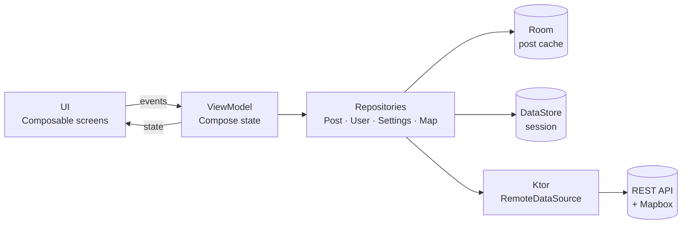

# Fotogram

**Native Android client for an image-based social network.**

Fotogram lets users share photos with a short caption and an optional location, browse a discovery feed, follow other people and explore geotagged posts on an interactive map. It is written entirely in Kotlin with Jetpack Compose and talks to a REST backend through Ktor, with a local cache for offline use.

<p align="center">
  
  
  
  
</p>

---

## Features

- **Frictionless sign-up**: create a profile with username, bio, date of birth and profile picture. The session is stored on device, so the app opens straight onto the feed on later launches.
- **Discover feed**: infinite scrolling list of posts with pull-to-refresh, skeleton (shimmer) placeholders while content loads and scroll position kept across navigation.
- **Posts**: image + caption + optional location. Tap an image to zoom, tap the author to open their profile, tap the location to jump to it on the map. Your own posts can be deleted from the post menu.
- **Create post**: pick an image from the gallery, write a caption and drop a pin on a Mapbox map; the address is resolved via Mapbox reverse geocoding.
- **Profiles**: followers / following / posts counters, follow and unfollow, the user's post history and an edit-profile screen for your own account.
- **Map**: every geotagged post cached on the device, shown as a custom pin with the author's name and image; camera zoom adapts to the selection.
- **Offline-aware**: posts are cached in Room and served from the cache first; network failures surface as snackbars and "You're offline · Retry" states instead of crashes.

## Tech stack

| Area | Libraries |
|---|---|
| Language | Kotlin 2.0 |
| UI | Jetpack Compose, Material 3, Compose Navigation (type-safe routes with `kotlinx.serialization`) |
| Async | Kotlin Coroutines, `StateFlow`, `viewModelScope` |
| Local storage | Room (post cache), Preferences DataStore (logged user + session ID) |
| Networking | Ktor Client (OkHttp engine) + `kotlinx.serialization` JSON |
| Maps & location | Mapbox Maps SDK v11 + Compose extension, Mapbox Geocoding API, Google Play Services Fused Location |
| Images | Coil, Base64 encoding/decoding for upload and display |
| Build | Gradle Kotlin DSL, version catalog, KSP |

## Architecture

The app follows **MVVM** with a repository layer between the UI and data sources.



```
UI (Compose)  →  ViewModel  →  Repository  →  Room / DataStore
                                          ↘  Ktor (REST API, Mapbox)
```

- **UI**: stateless-as-possible composables organised by feature (`features/`) plus a shared component library (`ui/components/`).
- **ViewModel**: one per screen or complex component; exposes Compose state (`mutableStateOf`) and runs work in `viewModelScope`.
- **Repository**: single source of truth for each domain. `PostRepository` reads from the Room cache first and falls back to the network; `UserRepository` keeps an in-memory `StateFlow` cache of users.
- **Data sources**: `RemoteDataSource` wraps every API call (session header, error mapping), `AppDatabase`/`PostDao` handle persistence.
- **Dependency wiring**: repositories are created in `MainActivity` and provided to the tree through `CompositionLocal`s; ViewModels receive them via `viewModelFactory`.

## Project structure

```
app/src/main/java/com/example/fotogramapp/
├── MainActivity.kt          # Entry point: builds Room, DataStore and repositories
├── app/
│   └── FotogramApp.kt       # App scaffold (top bar, navbar, snackbar host)
├── navigation/
│   ├── Routes.kt            # Type-safe @Serializable routes
│   ├── Navigator.kt         # NavHost
│   └── NavigatorViewModel.kt
├── features/                # One folder per screen (Page + ViewModel)
│   ├── signup/
│   ├── discover/
│   ├── createpost/
│   ├── profile/
│   │   ├── components/      # Bento-style profile stats
│   │   └── editprofile/
│   └── map/
├── ui/
│   ├── components/          # Reusable UI: post card, inputs, buttons, navbar, map pin…
│   └── theme/               # Colors, typography, icons, shimmer animation
├── data/
│   ├── database/            # Room database, DAO, type converters
│   ├── remote/              # Ktor data source, DTOs, serializers
│   ├── repository/          # Post, User, Settings, Map repositories
│   └── utils/               # Bitmap ↔ Base64 helpers
└── domain/
    └── model/               # Post, User
```

## Getting started

### Requirements

- Android Studio with support for AGP 8.13 (JDK 17)
- A device or emulator running **Android 16 (API 36)**: `minSdk` is currently 36
- Google Play services on the device/emulator (used for location)
- A free [Mapbox](https://account.mapbox.com/) account for the public access token

### 1. Clone

```bash
git clone https://github.com/WiktorVerga/FotogramApp.git
cd FotogramApp
```

### 2. Add your Mapbox token

The Mapbox SDK and the geocoding calls read the token from a string resource named `mapbox_access_token`, in:

```
app/src/main/res/values/mapbox_access_token.xml
```

```xml
<?xml version="1.0" encoding="utf-8"?>
<resources xmlns:tools="http://schemas.android.com/tools">
    <string name="mapbox_access_token" translatable="false"
        tools:ignore="UnusedResources">YOUR_PUBLIC_TOKEN_HERE</string>
</resources>
```

Use a **public** token (starts with `pk.`) from your Mapbox account page. If you fork the project, consider adding this file to `.gitignore` so your token is not committed.

### 3. Run

Open the project in Android Studio, let Gradle sync, then run the `app` configuration. From the command line:

```bash
./gradlew installDebug
```

On first launch the app shows the sign-up screen; after that it opens on the Discover feed. Grant the location permission when asked to centre the map on your position.

> The backend used by the app is configured in `RemoteDataSource.BASE_URL`.

## Testing

```bash
./gradlew test                  # JVM unit tests
./gradlew connectedAndroidTest  # Instrumented tests (needs a device/emulator)
```

At the moment the test folders contain only the default Android Studio templates: the project was focused on features and architecture first, and test coverage is the main gap I want to close (see below).

## Next steps

- **Dependency injection with Hilt**: replace the manual `CompositionLocal` + `viewModelFactory` wiring, make repositories singletons and simplify ViewModel creation.
- **More tests**: unit tests for repositories and ViewModels (fake `RemoteDataSource`, in-memory Room), Ktor `MockEngine` tests for the API layer, Compose UI tests for the main flows.
- **Secrets out of source control**: load the Mapbox token from `local.properties` via `BuildConfig`/`resValue` instead of a committed XML file.
- **Lower `minSdk`**: support older Android versions to reach real devices.
- **Unidirectional state**: move screens to a single immutable `UiState` exposed as `StateFlow`, and observe Room with `Flow` for automatic UI updates.
- **Paging 3** for the feed and profile lists, and moving location/permission logic out of ViewModels that hold a `Context`.
- **Cleanup**: align package names (`RemoteDataSource` still lives in a legacy package), remove unused navigation/fragment dependencies, centralise error handling.

## Author

**Wiktor Verga** · [GitHub](https://github.com/WiktorVerga) · [LinkedIn](https://linkedin.com/in/wiktor-verga)****